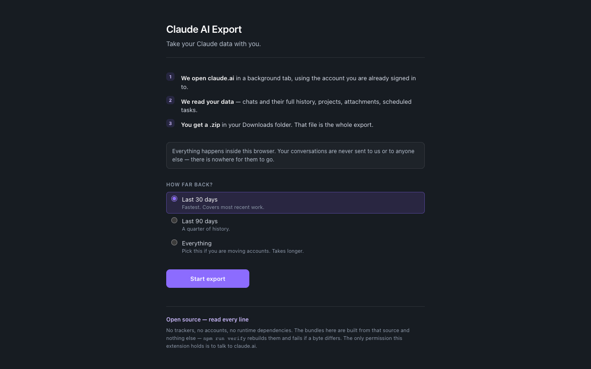
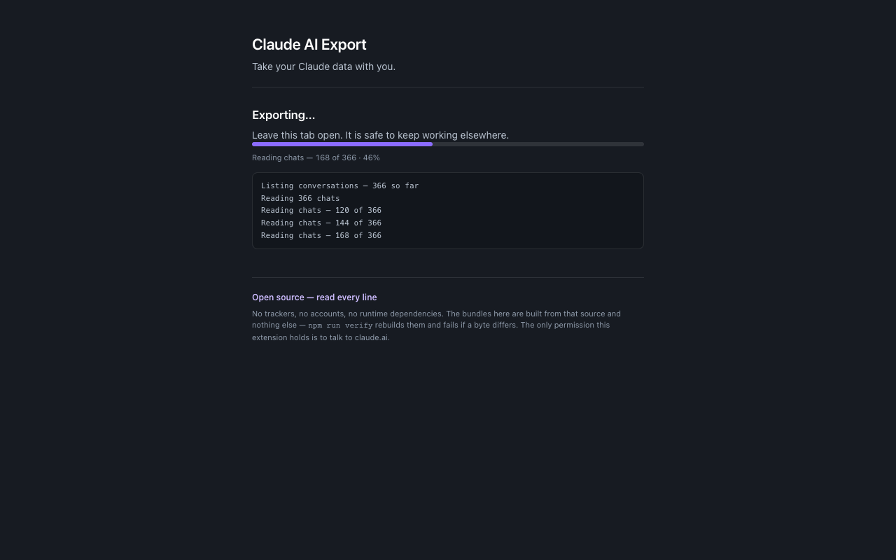
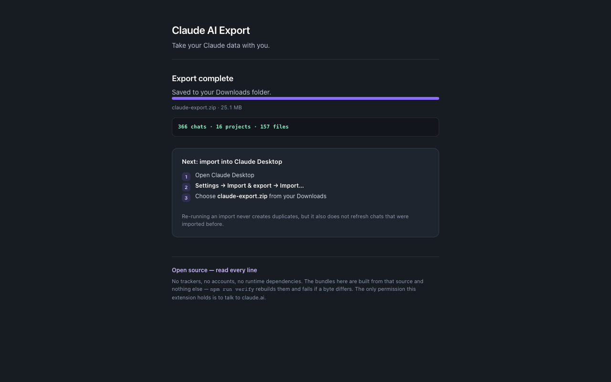
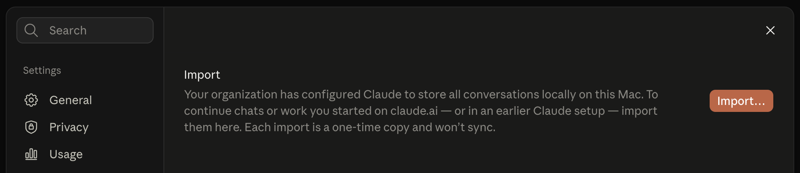
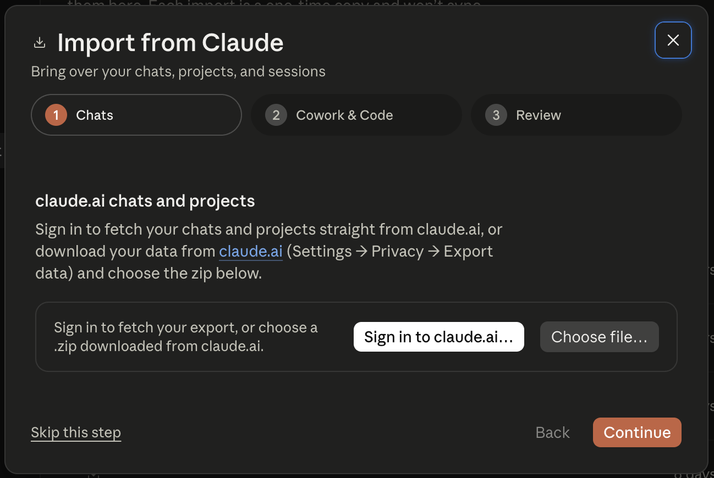

# Exporting and importing, step by step

The whole move, with screenshots. Three parts: export from claude.ai, import the
chats and projects into Claude Desktop, then the scheduled tasks — which need
their own step for reasons explained at the end.

---

## Part 1 — Export from claude.ai

Click the extension icon. It opens claude.ai for you if it needs to, and waits
if you are not signed in.



**Choose "Everything" if you are moving accounts.** The default is the last 30
days. On an account whose history is older, that produces an archive which looks
completely successful and holds almost nothing — around 600 KB where the full
export is 25 MB. The page tells you how many of your chats the window actually
covered.

Press **Start export**. A large history takes a few minutes.



You can close the tab. The export runs in a claude.ai tab and a background
worker, so neither closing this page nor Chrome tidying it away will stop it.



`claude-export.zip` lands in your Downloads folder.

### What is in the archive

```
conversations.json   every chat, with its full message tree
projects.json        projects, their instructions and knowledge documents
users.json           your account uuid, and nothing else about you
files/<uuid>         every attachment and image, as raw bytes
schedules.json       your scheduled tasks (see Part 3)
skipped.json         anything that could not be fetched, and why
blocktypes.json      which content block types your history contains
```

`skipped.json` is worth opening if the counts look low. Losing data quietly is
the failure this project cares most about avoiding, so anything that could not
be fetched is named there rather than dropped.

---

## Part 2 — Import chats and projects

Claude Desktop has a built-in importer when your organisation has it storing
conversations locally. It is Anthropic's supported path, and this project does
not replace it.

**Settings → Import & export**



Press **Import…**



**Step 1 — Chats.** Press **Choose file…** and pick your `claude-export.zip`.

Ignore **Sign in to claude.ai…** beside it. That fetches Anthropic's own member
data export, which is the feature most workspace admins have not enabled — it is
the reason this project exists. Trying it costs nothing, and if it works you do
not need any of this.

**Step 2 — Cowork & Code.** Local sessions from an earlier Claude install on
this machine. **Skip this step** unless you have some.

**Step 3 — Review.** It shows a count before committing anything. Check it
against what the export reported. Then **Import**.

Chats appear in the sidebar; projects become Spaces. The first message you send
in an imported chat asks **Resume imported session? → Trust and resume**. That
is expected, once per chat.

### Re-running an import

Each import is a one-time copy. Re-running it **never creates duplicates** —
session ids are derived from the source conversation, so the same chat always
lands in the same place.

But it also **never refreshes a chat already imported**. Existing sessions are
skipped, not updated. Re-running picks up conversations that are new since last
time and nothing else, so fixing a bad export means removing the previous import
first rather than importing over it.

---

## Part 3 — Scheduled tasks

```bash
curl -fsSL https://raw.githubusercontent.com/selan-ai/claude-ai-export/main/scripts/import.sh | bash
```

It finds your newest export, writes the tasks, and then opens Claude Desktop
with the archive already selected — so if you have not done Part 2 yet, this
saves you hunting through Downloads for it.

Only `bash`, `jq`, `unzip` and `date`, all of which ship with macOS 15 and
later. Nothing to install. It backs up whatever it replaces and prints the undo
command.

Afterwards the tasks are under **Scheduled** in the sidebar.

### Why they cannot go through the wizard

The importer reads five things out of the archive — `conversations.json`,
`projects.json`, `users.json`, `manifest.json` and `files/` — and nothing else.
There is no field for a schedule anywhere in that schema, so no archive you
could construct would carry one.

Desktop's own scheduled tasks are not server data either. They are a local JSON
record plus a skill file on disk, which is what the script writes.

### The timezone, which is the part that bites

claude.ai stores cron expressions in **UTC**. Claude Desktop runs them in your
machine's **local time**. Copying one across unchanged fires it at the wrong
hour — a task set for 08:00 in Vilnius is stored as `0 5 * * 1`, and pasted into
Desktop unchanged it would arrive at five in the morning.

The script converts each one, and reports what it did:

```
Monday good morning message: 0 5 * * 1 UTC → 0 8 * * 1 local
```

Anything more complicated than a plain daily or weekly rule is left untouched
and flagged, rather than converted incorrectly and left looking fine.

---

## What does not come across

| | |
|---|---|
| Memory | claude.ai has no export for it |
| Artifacts | they live inside the message text, and arrive with it |
| Connectors on a scheduled task | Desktop uses whatever connectors it has |
| Run history of a scheduled task | the chats each run produced do come across, as ordinary conversations |

## If something looks wrong

- **Far fewer chats than expected** — check the date range you chose, and read
  the line on the completion screen saying how many of your chats it covered.
- **Missing attachments** — open `skipped.json` in the archive. Files that could
  not be fetched are listed there with a reason.
- **The import found nothing** — the wizard shows a count before importing. If
  that count is zero, the archive is the problem, not Desktop.
- **A task at the wrong time** — see the timezone note above; the script prints
  every conversion it makes.

Both the claude.ai API and Desktop's importer are undocumented internals and can
change without notice. If numbers do not add up, open an issue with the counts
from the export page and from the wizard.
